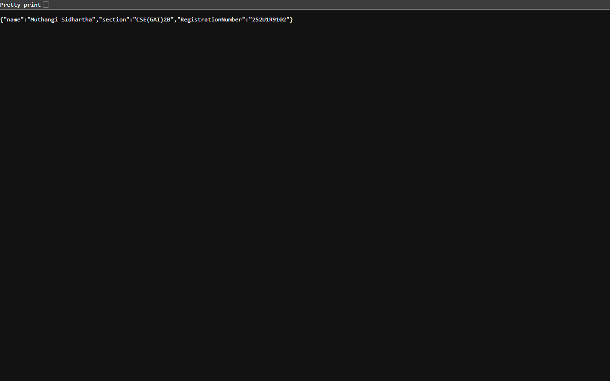
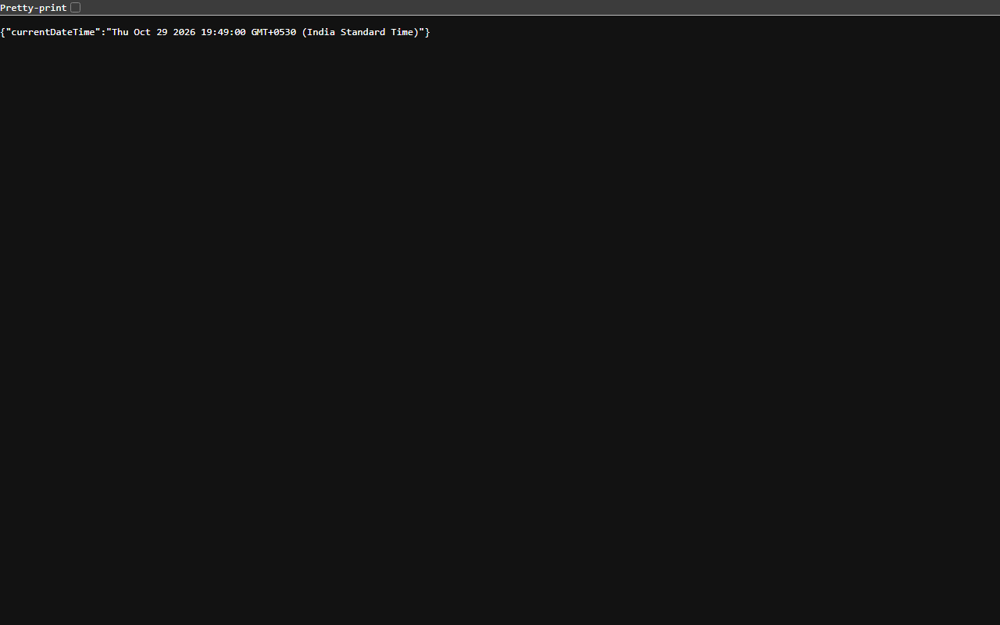

# Lab 1: Node.js and Express server

**Name:** Muthangi Sidhartha  
**Registration number:** 252U1R9102  
**Section:** CSE(GAI)2B

**Live link:** Not deployed. A hosting account and deployment authorization were not available in this workspace.

## How to install and run

Requires Node.js and npm.

```bash
npm install
npm start
```

The Express server listens on port `3000` by default. To use a hosting platform's port, set the `PORT` environment variable before starting the server. No other environment variables are required. Do not commit a `.env` file.

To run the plain Node.js HTTP server instead, stop the Express server and run:

```bash
npm run start:http
```

Both server scripts use the `PORT` environment variable (default `3000`), so run only one at a time.

## Endpoints

| Method | Path | Description | Status |
|---|---|---|---|
| GET | `/` | Returns a welcome message. | 200 |
| GET | `/about` | Returns the student's name, section, and registration number as JSON. | 200 |
| GET | `/time` | Returns the current server date and time as JSON. | 200 |
| GET | Any other path | Returns a not-found message. | 404 |

## Screenshots

These screenshots show responses from the locally running server.







## Notes

- The project is not deployed because hosting credentials and authorization were not available. These are local browser screenshots, not Postman captures; add Postman screenshots of each endpoint if submitting without a deployment.
- The plain HTTP and Express servers both use port `3000`; stop one before starting the other.
- `package.json` records project metadata and dependencies; `node_modules/` contains the installed dependency files and is excluded from Git.
- `app.listen()` starts the Express server and makes it listen for incoming requests on a port.
- A request represents data sent by a client to the server; a response is what the server sends back, including a status code and content.
