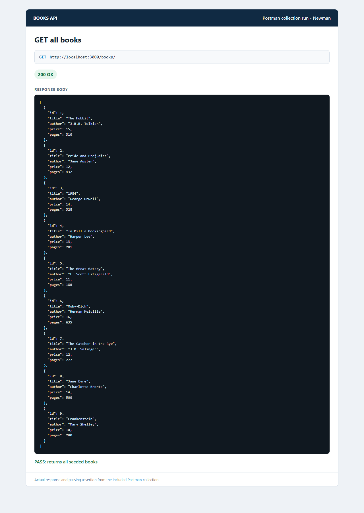
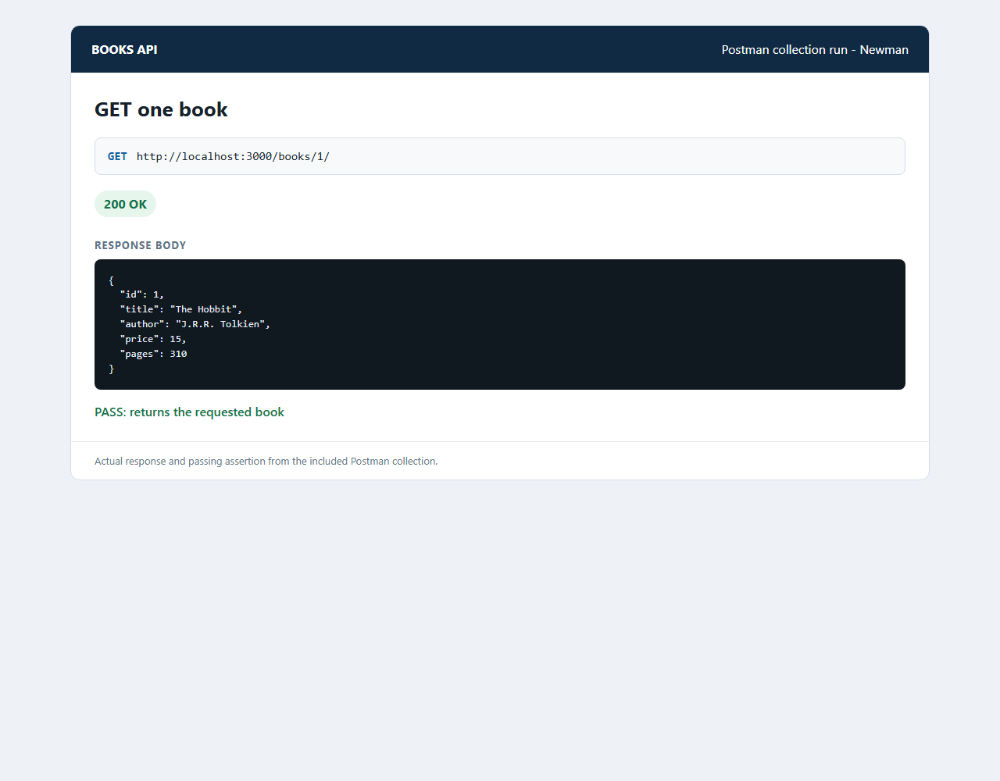
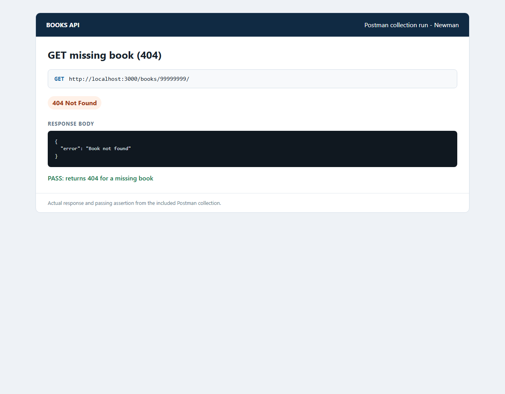
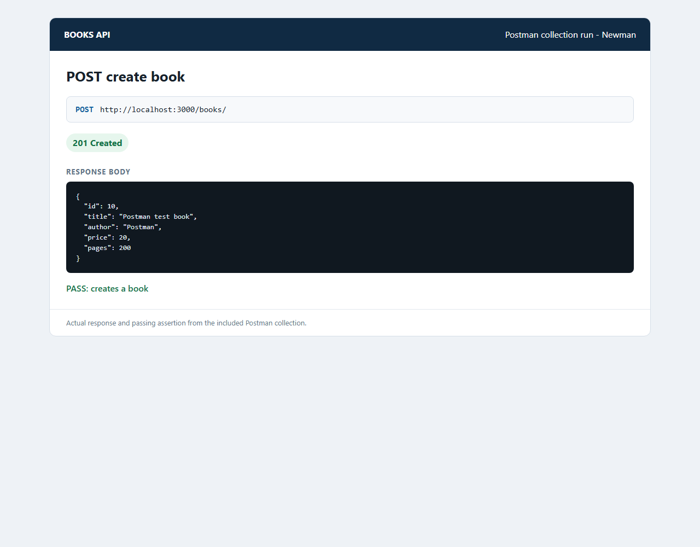
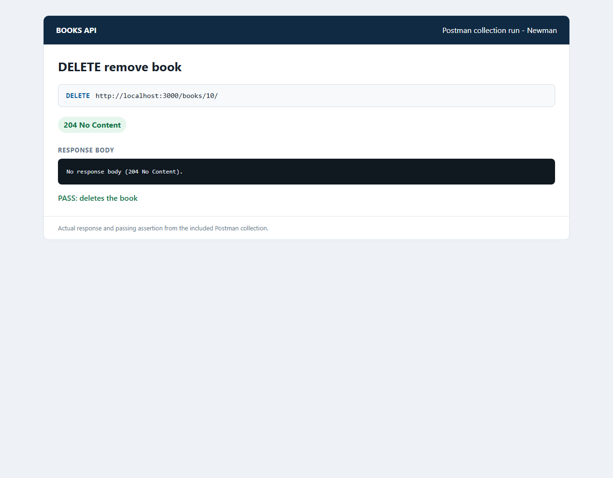
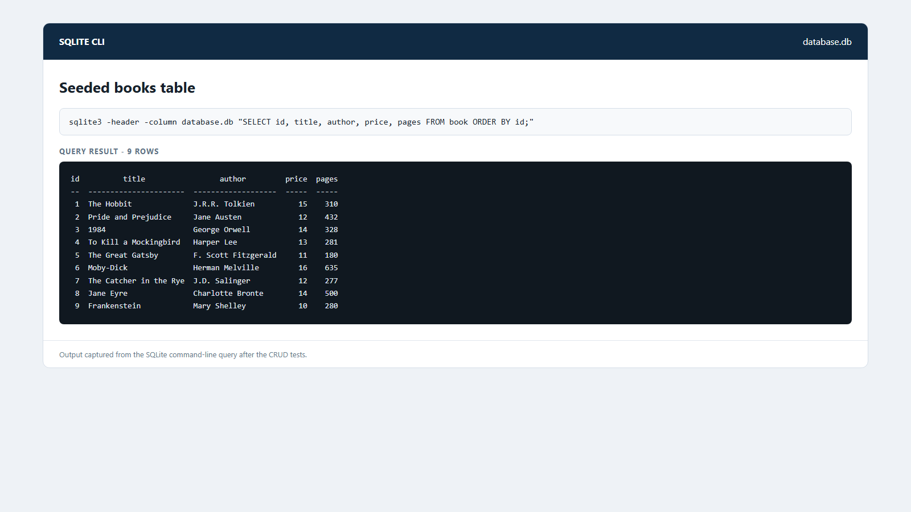

# Lab 2: SQLite database and CRUD routes

**Name:** Muthangi Sidhartha

**Registration number:** 252U1R9102

**Section:** 111

## Live link

Not deployed. This lab uses a local SQLite database file. No public hosting service or persistent disk has been configured for this project. The API can be run locally and tested with the included Postman collection.

## How to run

From the `lab-02/` folder:

```sh
npm install
npm start
```

The server listens on port `3000` by default. To use a different port, set the optional `PORT` environment variable before starting the server. No `.env` file or other environment variables are required. The server creates the `database.db` file and `book` table if they do not exist; the included database is already seeded with nine books.

To re-run the idempotent seed script or inspect the database with the SQLite CLI:

```sh
sqlite3 database.db ".read seed.sql"
sqlite3 database.db "SELECT * FROM book ORDER BY id;"
```

## Endpoints

| Method | Path | Description |
| --- | --- | --- |
| GET | `/books/` | Return all books. |
| GET | `/books/:bookId/` | Return the book with the requested ID, or `404` if absent. |
| POST | `/books/` | Add a book from a JSON body; returns `201` when created. |
| PUT | `/books/:bookId/` | Replace a book's fields; returns `404` if the ID is absent. |
| DELETE | `/books/:bookId/` | Remove a book; returns `204` when deleted or `404` if absent. |

POST and PUT require JSON fields `title` (string), `author` (string), `price` (integer), and `pages` (integer). User-provided SQL values are bound using `?` placeholders.

## Screenshots and Postman tests

Import [`Books API.postman_collection.json`](Books%20API.postman_collection.json) into Postman and run the requests in order. The POST request stores its new ID for the PUT and DELETE requests. The screenshots below show the actual responses and passing assertions from the collection run with Newman, Postman's CLI runner.














## Notes

- The SQLite database is opened before the server starts listening.
- `npm start` uses nodemon and watches JavaScript, JSON, and SQL files.
- The database is a local file, so a deployed service would need persistent disk storage to retain writes across restarts. No deployment was configured for this lab.
- The API and Postman collection were verified locally; the included `.db` file contains nine seeded rows.

## Viva quick answers

- **Why await the database call?** SQLite operations complete asynchronously. `await` lets the route wait for the result before responding, and lets initialization wait for the database connection before opening the HTTP listener.
- **What is SQL injection, and how do placeholders help?** SQL injection is when untrusted input is interpreted as part of an SQL command. Parameterized queries bind input values separately from the SQL text, so input is treated as data rather than executable SQL.
- **When is PUT used instead of POST?** POST is used here to create a new book. PUT targets a known book ID and replaces that book's fields.
