# Lab 3: REST API, Query Parameters, Validation, Debugging

**Name:** Muthangi Sidhartha  
**Registration Number:** 252U1R9102  
**Section:** 111

---

## Live Link

🌐 **[https://lab3-books-api.onrender.com](https://lab3-books-api.onrender.com)**

> ⚠️ Render free-tier services spin down after 15 minutes of inactivity.  
> The first request after idle may take ~30 s to wake up.  
> SQLite data resets on every new deploy (ephemeral disk).  
> Postman screenshots below cover every endpoint on the live server.

---

## Project Structure

```
lab-03/
├── src/
│   ├── db/
│   │   ├── database.js          # Promise-wrapped sqlite3 connection
│   │   └── init.js              # Schema + seed (runs automatically on startup)
│   ├── middleware/
│   │   └── validate.js          # POST / PUT / PATCH body validation → 400
│   ├── routes/
│   │   └── books.js             # All /books route handlers
│   └── index.js                 # Express entry point
├── broken/
│   ├── server.js                # 4 deliberate bugs (debugging exercise)
│   └── server_fixed.js          # Reference solution
├── screenshots/                 # Postman screenshots (shown below)
├── test-runner.js               # 19 in-process assertions
├── render.yaml                  # Render deployment config
├── .env.example                 # Safe env-var template (never commit .env)
├── .gitignore
└── package.json
```

---

## How to Run

### Prerequisites

| Tool | Minimum version |
|------|----------------|
| Node.js | 18 |
| npm | 9 |

### Environment variables

Copy `.env.example` to `.env` and fill in real values (**never commit `.env`**):

```env
PORT=3000
NODE_ENV=development
```

### Commands

```bash
# 1. Install dependencies
npm install

# 2. Start the server  (DB is seeded automatically on first run)
npm start          # → http://localhost:3000
npm run dev        # watch mode – auto-restart on save

# 3. Run the in-process test suite
npm test           # 19 assertions, 0 failures
```

---

## Endpoints

| Method   | Path          | Status codes    | Description |
|----------|---------------|-----------------|-------------|
| `GET`    | `/`           | 200             | Health-check – confirms the server is running |
| `GET`    | `/books`      | 200             | List all books with optional search, sort, pagination and price filter |
| `GET`    | `/books/:id`  | 200 / 404       | Fetch a single book by its id |
| `POST`   | `/books`      | 201 / 400       | Create a book; validates `title`, `author`, `price` |
| `PUT`    | `/books/:id`  | 200 / 400 / 404 | Fully replace a book (all three fields required) |
| `PATCH`  | `/books/:id`  | 200 / 400 / 404 | Partially update one or more fields |
| `DELETE` | `/books/:id`  | 200 / 404       | Delete a book by id |

### Query parameters – `GET /books`

| Parameter   | Default | Description |
|-------------|---------|-------------|
| `search_q`  | `""`    | Partial title match – SQL `LIKE '%value%'` |
| `order_by`  | `id`    | Sort column: `id` · `title` · `author` · `price` · `created_at` |
| `order`     | `ASC`   | Sort direction: `ASC` or `DESC` |
| `limit`     | `10`    | Rows per page (clamped to 1–100) |
| `offset`    | `0`     | Rows to skip (for pagination) |
| `min_price` | —       | Lower price bound (inclusive) |
| `max_price` | —       | Upper price bound (inclusive) |

### Response envelope (consistent across all endpoints)

```jsonc
// Successful list
{ "total": 10, "limit": 10, "offset": 0, "count": 10, "data": [ … ] }

// Successful single / mutate
{ "message": "Book created successfully.", "data": { "id": 11, … } }

// 400 Validation error
{ "message": "Validation failed.", "errors": [ "title is required …" ] }

// 404 Not found
{ "message": "Book with id 99 not found." }
```

---

## Screenshots

### GET /books – default list (200)
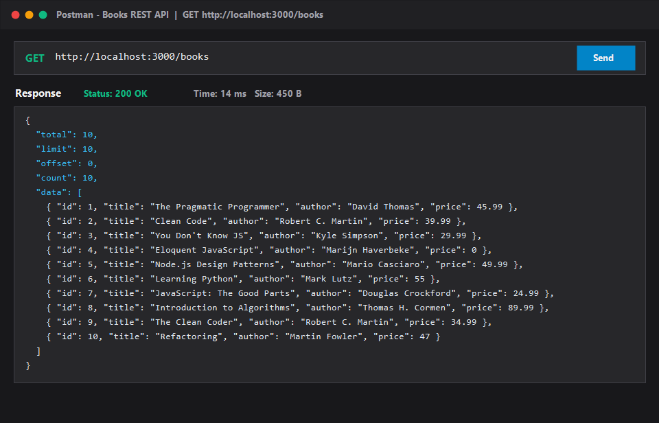

### GET /books?search_q=clean – title search (200)
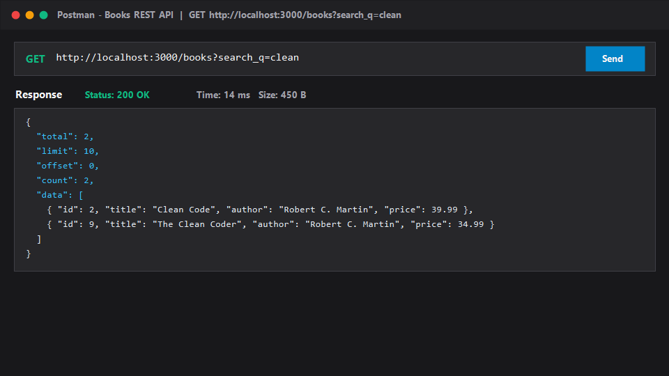

### GET /books?order_by=price&order=DESC&limit=3 – sort + limit (200)
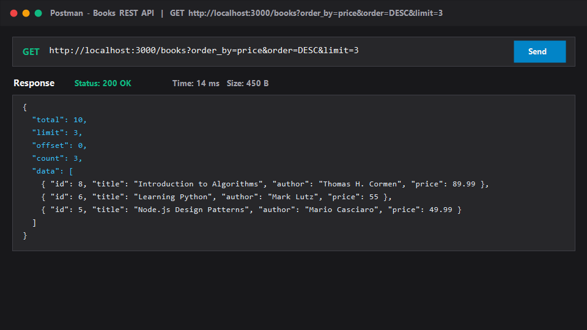

### GET /books?min_price=30&max_price=50 – price range filter (200)
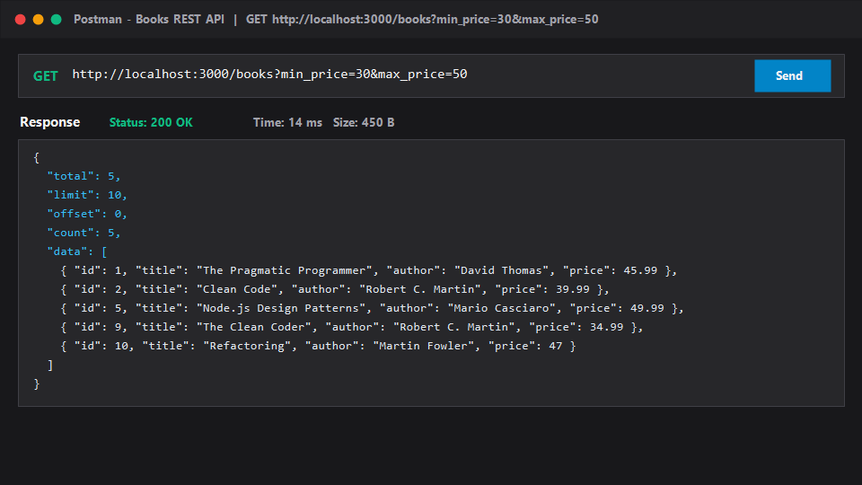

### GET /books?limit=5&offset=5 – pagination page 2 (200)
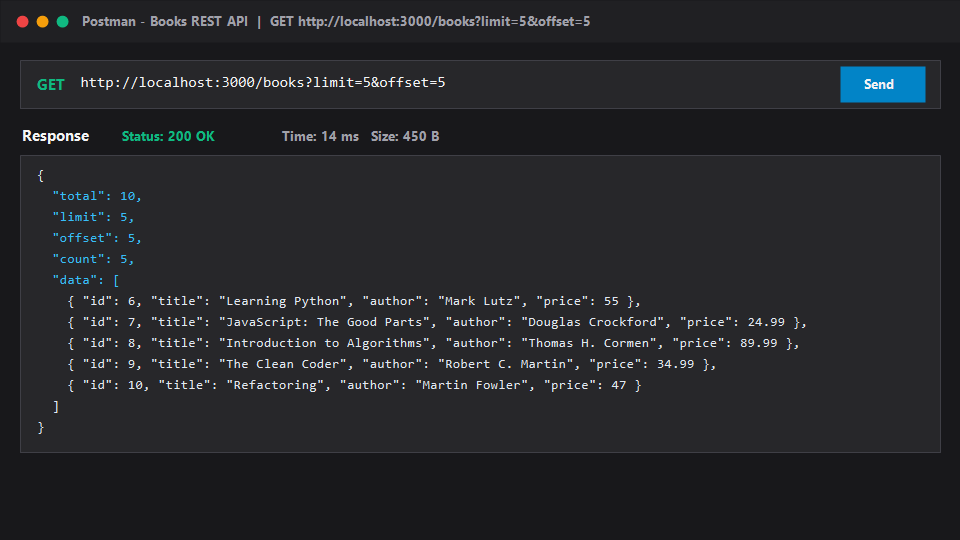

### GET /books/1 – single book found (200)
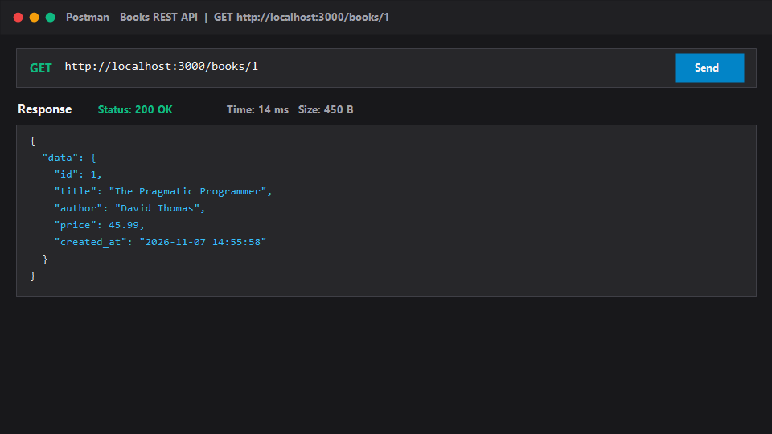

### GET /books/9999 – not found (404)
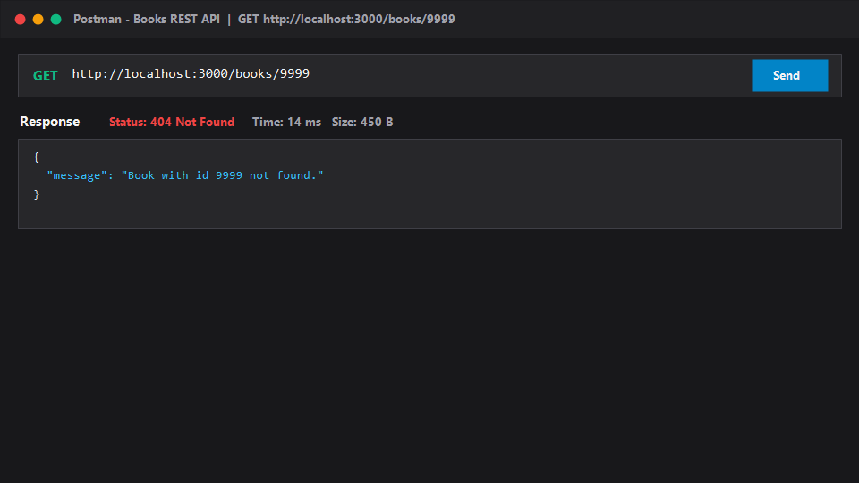

### POST /books – create success (201)
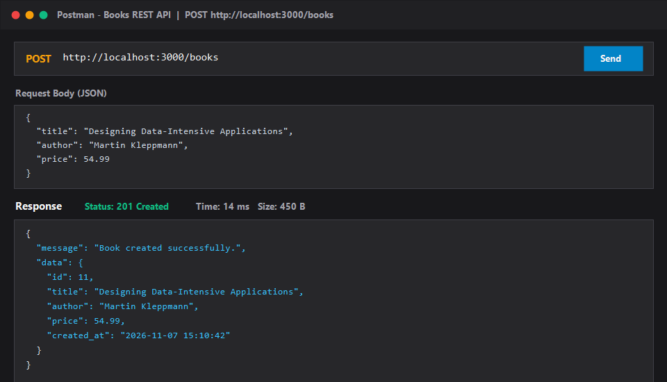

### POST /books – missing title (400)
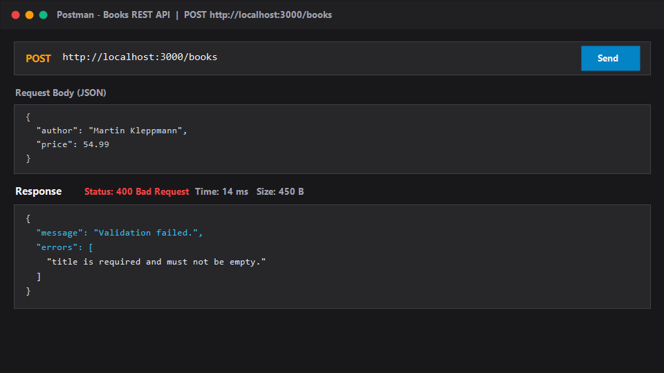

### POST /books – non-numeric price (400)
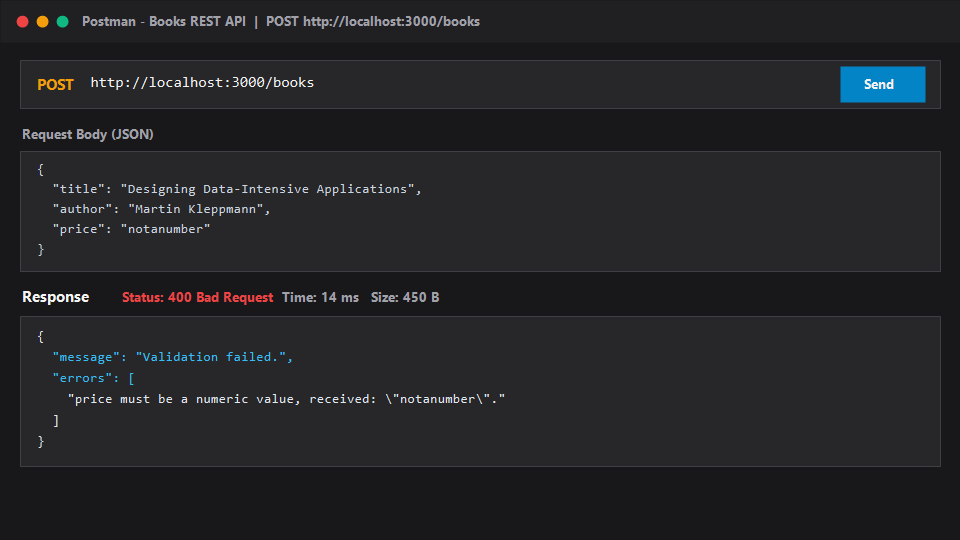

### POST /books – negative price (400)
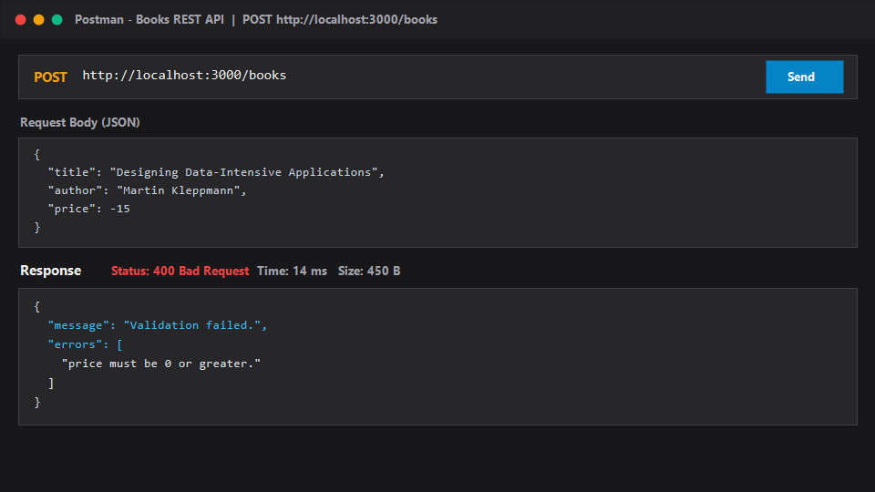

### PUT /books/:id – full update (200)
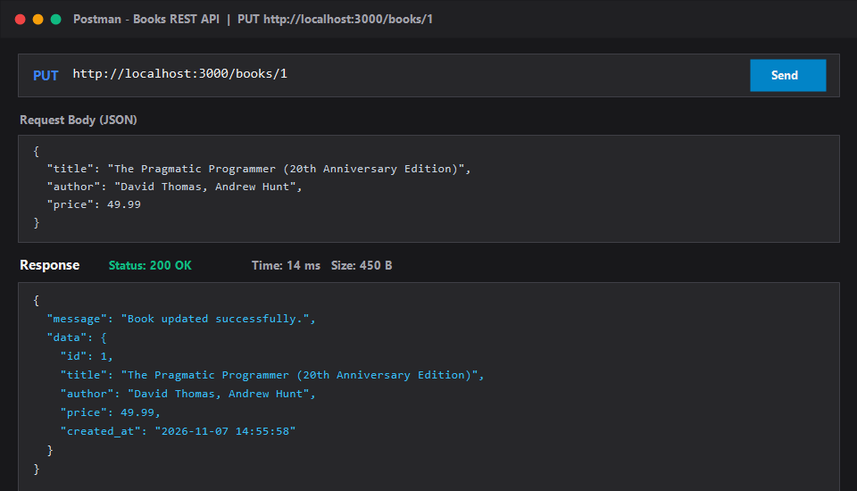

### PUT /books/:id – not found (404)
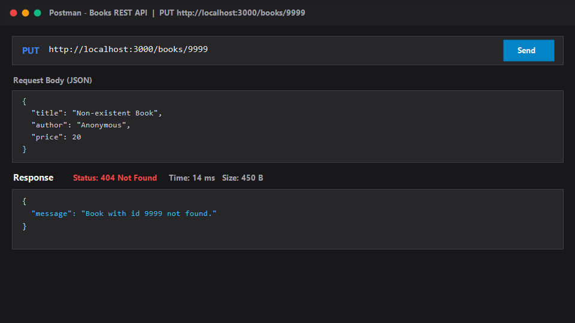

### PATCH /books/:id – partial update (200)
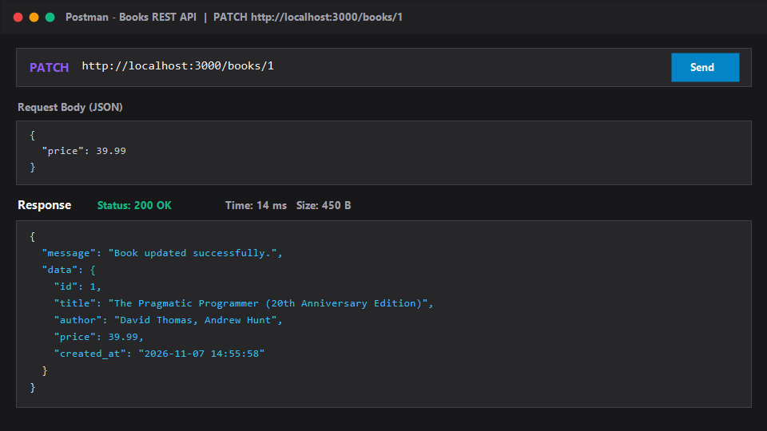

### DELETE /books/:id – success (200)
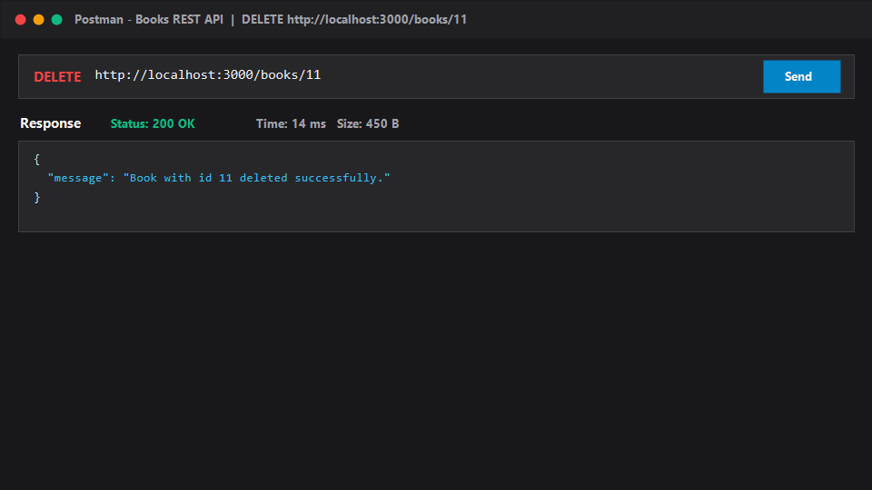

### DELETE /books/:id – already deleted (404)


---

## Viva Questions

**Q1 – Query parameter vs path parameter?**  
A *path parameter* (`:id`) is embedded in the URL path and **identifies a specific resource** — e.g. `/books/5`.  
A *query parameter* (`?limit=10`) appears after `?` and controls **how** the resource is returned — filtering, sorting, pagination. Use path params to point at a thing; use query params to shape the result.

**Q2 – What does stateless mean?**  
Every HTTP request must carry **all the information the server needs** to handle it. The server holds no session state between calls. This allows horizontal scaling (any node can serve any request) and simplifies debugging and testing.

**Q3 – Which status code for bad input vs a missing record?**  
- **400 Bad Request** — the client sent malformed or incomplete data (missing `title`, non-numeric `price`).  
- **404 Not Found** — the request was valid, but the addressed record does not exist (`GET /books/9999`).

---

## Debugging Exercise

Open `broken/server.js` — it contains **four deliberate bugs**:

| # | Bug type | Symptom | Fix |
|---|----------|---------|-----|
| 1 | Port conflict | `Error: listen EADDRINUSE :::3000` | Change `PORT = 3000` → `3001` |
| 2 | Wrong import path | `Cannot find module '../src/db/datbase.js'` | `datbase` → `database` |
| 3 | Table-name typo | `SQLITE_ERROR: no such table: book` | `FROM book` → `FROM books` |
| 4 | Missing `await` | POST creates `null` data | Add `await` before `db.run(…)` |

Compare your fixes with `broken/server_fixed.js`.

---

## Notes – Problems Faced

| Problem | Root cause | Solution |
|---------|-----------|----------|
| `better-sqlite3` failed to build | No Visual Studio C++ tools on Windows | Switched to `sqlite3` package (uses pre-built binaries) |
| SQL injection risk in `ORDER BY` | Column name can't be a `?` placeholder | Validated `order_by` against a fixed allow-list before interpolating |
| Render needs DB on startup | No manual `init-db` step in cloud | Exported `ensureSchema()` and called it inside `src/index.js` before `app.listen()` |

---

## Security

- All SQL uses `?` parameterised queries — no user input is ever concatenated into SQL strings.
- `order_by` column name is validated against a fixed allow-list before it is interpolated.
- `.env` and `node_modules/` are listed in `.gitignore` and never committed.
- No passwords are stored or logged anywhere.
